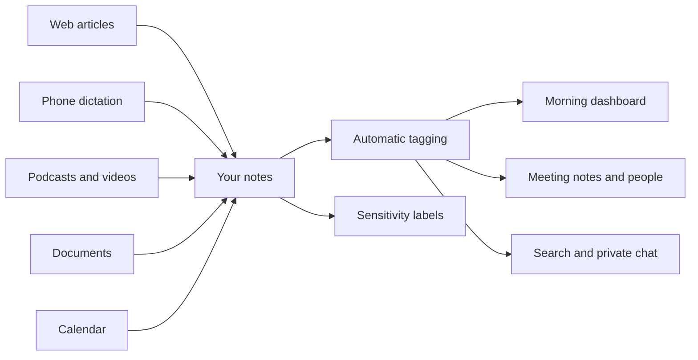

# Overview

This project is a ready-made "second brain": a personal notes system built on Obsidian, a free note-taking app, plus a set of background helpers that collect, tidy and organize what you read, hear and discuss. It is designed for leaders and knowledge workers who manage large teams, sit in many meetings, and need to keep track of people, groups and projects without spending their evenings filing notes.

## The problems it solves

Information arrives everywhere. An article in the browser, a thought dictated on a walk, a podcast worth keeping, a document someone emailed you. Most of it ends up scattered across apps and inboxes, and the useful part is hard to find a week later.

Meetings need preparation. Before a one-on-one you want to know what you promised last time and what is still open. Pulling that together by hand is tedious, so it often does not happen.

Notes rot when nobody organizes them. A folder of untagged notes becomes a pile you stop trusting. Keeping labels consistent takes discipline most people do not have time for.

AI tools raise fair privacy questions. It is reasonable to ask where your notes go when an AI reads them, and who can see them afterwards.

## What it does for you

### Capture from anywhere

- **Save web articles in one click.** A browser extension, also available from the share button on iPhone and iPad, saves any page you can read, including subscriptions you are signed in to, as a clean note.
- **Dictate from your phone.** Speak a note into an iPhone shortcut and it arrives a few minutes later as a polished, readable note.
- **Keep podcasts and videos.** Point it at a podcast episode and it writes a full transcript on your own computer. Give it a YouTube video or playlist and it writes a short summary note.
- **Convert documents.** Drop a Word, Excel, PowerPoint or PDF file onto a small converter and it becomes a searchable note, with its images kept.

### Organized for you

- **Automatic tagging.** Tags are short topic labels that make notes easy to group and find. A background helper reads each new note and applies a handful of tags, chosen only from the list you already use, so your labels stay consistent instead of multiplying.
- **People and groups.** Every person gets a record with their photo, role and a running history of the meetings you have had together. Team rosters show each member's photo next to their name.
- **Tasks in one place.** Write a to-do inside any note and it shows up in a single list of everything open across your notes.
- **A weekly tidy-up check.** Once a week it looks for duplicate or misspelled tags, near-duplicate notes and broken links, and reports them. It changes nothing unless you ask it to.

### Ready for your day

- **A morning dashboard.** Each weekday morning a single page opens in your browser showing your open to-dos, today's meetings, what you captured since midnight, and whether the background helpers are healthy. Every item links straight back to the note.
- **Meeting notes written before you sit down (optional).** If your calendar can be connected, it creates the day's meeting notes early each weekday morning, with attendees already linked to their records.
- **Requests from your inbox, as to-dos (optional).** Each weekday morning it finds the emails asking something of you personally (approvals, direct requests, small-team asks) and adds each as a to-do with a link back to the message. Approvals come first, and an approval that looks like phishing is flagged to verify.
- **Open follow-ups in front of you.** During business hours it adds the still-open tasks for a person into that day's one-on-one meeting note, so the conversation starts from what is outstanding.
- **Chat with your notes (optional).** On a sufficiently powerful computer you can ask questions of your notes in a private chat window that runs entirely on your own machine.

### Private and secure by design

- **Your notes stay files you own.** Everything is stored as plain text files on your computer, readable by any editor, with no lock-in.
- **Sensitive material is flagged.** A nightly helper suggests a sensitivity level for each changed note and automatically marks obvious items such as Social Security numbers, private keys or access tokens as restricted. It only ever raises a level, and you accept or reject each suggestion. An export check then refuses to share a note above the level its audience is cleared for.
- **Tamper monitoring.** Daily checks watch the add-ons and background helpers for unexpected changes, and warn you if a large number of notes suddenly disappears.
- **Phone captures are verified.** Notes sent from your phone carry a signature, and anything that fails the check is ignored rather than added to your notes.

### Works on Mac and Windows

The same notes and helpers run on a Mac or a Windows PC, set up by a guided installer on each. A few features take a different form on Windows: the document converter is a right-click "Send to" shortcut instead of a drag-and-drop window, and the nightly sensitivity check is not yet scheduled there, though it can be run by hand. Each platform's setup guide says what differs.

## How it fits together

## What it takes

- **Obsidian**, which is free, on an Apple Silicon Mac or a Windows PC.
- **A guided installer** that sets up the folders, add-ons and background helpers and asks you to confirm each step. Many features are optional and can be left out.
- **An AI service for the assisted features.** Tagging, dictation cleanup, video summaries and sensitivity suggestions send the text of the note being processed to a cloud AI service. That is either Anthropic, using your own API key, or your institution's AI gateway if it runs one. Notes marked restricted, the highest sensitivity level, are held back unless you are using an institutional gateway whose agreement covers them and you choose to allow it. Keep this in mind for anything you would not want leaving your computer.
- **Local-only options.** The private chat over your notes and the podcast transcription run on your own machine and send nothing out. The chat needs a capable computer with plenty of memory.
- **A dedicated email inbox** if you want to send dictation or podcasts from your phone, since that is how phone captures travel to your computer.
- **Obsidian Sync** (a paid subscription) if you want your notes on your phone and tablet. It keeps them end-to-end encrypted across your devices.

## Where to go next

- [Quick Start](../README.md#quick-start) for installing on Mac or Windows.
- [Technical overview](Technical-Overview.md) for how the pieces work.
- [Security overview](Security-Overview.md) for the protections and what data goes where.
- [Demo content](Demo-Content.md) to try it first with an invented company and fictional people, then remove it in one step.
