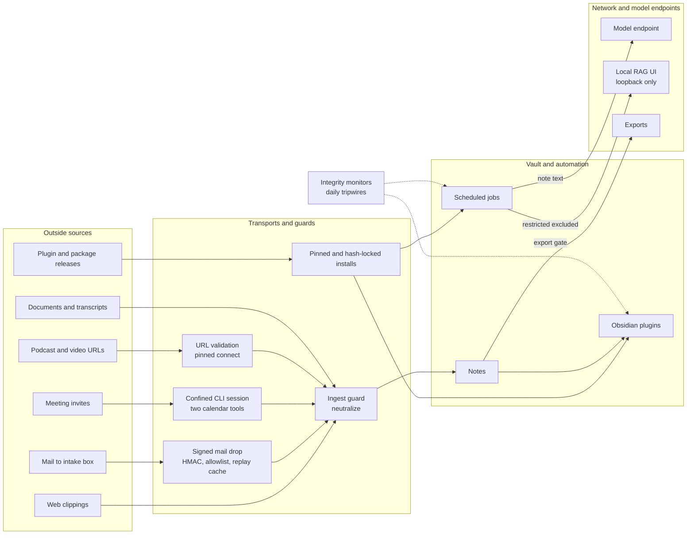

# Security overview

This page is the whole security picture on one page, for a security
engineer, an IT risk reviewer or a careful adopter. It names every control,
says what each one stops or detects and where it runs, and states the limits
plainly. The detailed documents it links to are the reference; this page does
not repeat them. For what the workflow does, start with
[`Overview.md`](Overview.md); for how it is built,
[`Technical-Overview.md`](Technical-Overview.md).

## Summary

The workflow protects three things. The first is the vault's content: notes
that can hold meeting discussion, personal records and anything else a person
writes down. The second is the automation that runs as the user: scheduled
Python jobs, their virtualenv, their scheduler entries and the Obsidian
plugins that load inside the app. The third is this public repository, which
must never carry anyone's real notes, names or secrets. The stance is layered
controls rather than one wall. Where something can be refused before it lands
(an unsigned mail drop, a plugin file that does not match its pin, an export
above its audience's tier), it is refused. Where it cannot be prevented by
code running as the same user, it is detected and reported. Checks that cannot
see what they need fail closed rather than reporting a clean pass. Each
control's limits are written down next to it, and the main ones are collected
in [What this does not do](#what-this-does-not-do).

## Threat model

### In scope

- **Someone who controls text the pipelines ingest.** A web page clipped into
  `Clippings/`, a message sent to the intake mailbox, a meeting invite read by
  the unattended calendar session, a podcast feed, a YouTube page, a document
  dropped for conversion. The attacker's goals are to run code (through a
  plugin that executes note text, or through a model session with tools), to
  read data they should not (through a model session, a crafted URL that
  reaches a local service, or a rendered query that leaks note text), or to
  get content filed where it should not be.
- **A malicious or compromised Obsidian plugin or Python dependency.** An
  upstream release swapped behind the same version, a hijacked repository, or
  a dependency that changes under a pin.
- **Mistakes that would publish private data.** A real note, a colleague's
  name, an internal hostname or a credential committed to this public
  repository, or a confidential note exported to a wider audience than it is
  cleared for.

### Not a boundary

Code already running as the user is not an adversary these controls can
stop. Every job, monitor and secret lives under the same account, so such code
can read the keystore and silence the monitors. The integrity controls are
tripwires against it, not walls, and process-level monitoring of it is left to
endpoint security (see [What this does not do](#what-this-does-not-do)).

## Trust boundaries



Web clippings reach the guard late: the Web Clipper writes the note itself,
and `strip_ads` neutralizes it seconds to minutes afterwards (see
[the guard's limits](#outside-text)).

## Controls at a glance

| Control | What it stops or detects | Where it runs | Details |
|---|---|---|---|
| Plugin release pinning | A plugin file that differs from the reviewed release; an ambient "latest" | Install, and every update that moves the pins or finds a plugin off its pins | [Security-Harness.md](Security-Harness.md) |
| Plugin integrity check | Changed plugin code or manifest, a newly enabled plugin, a changed code-running setting, a hand-edited allowlist | Scheduled daily, and on change to the plugins folder (macOS) | [Security-Harness.md](Security-Harness.md) |
| Workflow integrity monitor | Changed scripts, scheduler entries, venv, templates, job settings, Claude CLI config, secrets file and bytecode; bulk note deletion | Scheduled daily, and on change to scripts or LaunchAgents (macOS) | [Security-Harness.md](Security-Harness.md) |
| Ingest guard | Outside text that would act as plugin code: in the shipped Tasks, Meta Bind, Metadata Menu and core Bases, and in Templater, Dataview and Excalidraw for a vault that installs them |  Every job that writes outside text into the vault | [Security-Harness.md](Security-Harness.md) |
| Confined headless Claude sessions | A crafted invite or diff steering a model session to a shell, files or other connector tools | Every meeting pull and email-tasks run; every drift review | [Meeting-Handoff-MCP-Producer.md](Meeting-Handoff-MCP-Producer.md), [Email-Tasks.md](Email-Tasks.md), [Drift-Review.md](Drift-Review.md) |
| Signed mail-drop transport | Forged, altered, retargeted or replayed capture drops; path traversal | Every mail pull (every 300 seconds on macOS) | [Source-Mail-Transport.md](Source-Mail-Transport.md) |
| Platform keystore for secrets | API keys and app passwords sitting in a plaintext file | Install; every job that reads a secret | [Windows Setup.md](Windows%20Setup.md) |
| Hash-locked dependencies, pinned models | A changed or tampered package or model file reaching the venv or a transcription backend | Install and update; every model load | [README.md](../README.md) |
| URL validation | URLs from feeds or drops reaching loopback, private or metadata addresses, including by redirect or DNS rebinding | Every fetch of a URL the operator did not type | [YouTube Summarizer.md](YouTube%20Summarizer.md) |
| Local RAG UI on loopback | The vault-wide RAG index being reachable from the network | Install and update; the `dast` pass | [Local LLM with Obsidian Vault RAG.md](Local%20LLM%20with%20Obsidian%20Vault%20RAG.md) |
| Dashboard action scheme | A web page using the dashboard's URL scheme to run arbitrary actions or adopt a baseline | Every click | [Dashboard-Actions.md](Dashboard-Actions.md) |
| Classification assistant | Sensitive notes left at the template default tier | Scheduled nightly, with catch-ups | [Data-Classification.md](Data-Classification.md) |
| Export gate | Content leaving at a tier above its audience, including through embeds and queries | Every export or check | [Data-Classification.md](Data-Classification.md) |
| One-command updates | Updating over local edits or a running Obsidian; silently adopting a baseline; leaving retired jobs and plugins installed | Every update | [README.md](../README.md), [Windows Setup.md](Windows%20Setup.md) |
| Repository hygiene | Real notes, names, addresses or credentials reaching the public repository; stale git hooks | Install (recipient side), every commit, every push | [Data-Classification.md](Data-Classification.md), [CLAUDE.md](../CLAUDE.md) |
| Standing security checks | Vulnerable dependencies, unsafe code patterns, shell errors, secrets, stale hooks, non-public content, regressions in the dynamic controls | Commit (`--fast`), push (`--full`), before a release | [CLAUDE.md](../CLAUDE.md) |
| Accepted-findings file | Accepted risks going unargued or outliving their reason | Every `sast` pass | [CLAUDE.md](../CLAUDE.md) |
| Per-push drift review | Documents that the pushed change made false | Every push, in the background, when configured | [Drift-Review.md](Drift-Review.md) |

## Controls by layer

### Supply chain

Community plugins install only from `installers/plugin-pins.json`, which names
each plugin's release tag, the exact download URL of each file and its
SHA-256. The installer downloads into a staging directory, hashes each file,
and on a mismatch refuses with nothing moved into place. Upgrading a plugin is
a deliberate re-pin with `installers/lib/pin_plugins.py` and a commit, so the
review moment is the diff of the pin file. One deployed file differs from its
pin by design: `quickadd_patch.py` rewrites a call in QuickAdd's `main.js`
after install. The accurate claim is that every plugin was verified against
its pin before installation, not that every deployed file matches it.

Python dependencies follow the same shape. `requirements.txt` says what is
needed; `requirements.lock` (and the `-dropper` and `-dev` pairs) pins every
package, dependencies included, with the hash of every file. Every pip step in
both installers and both updaters installs only a lock, with
`--require-hashes --no-deps --only-binary :all:`; the last flag stops a source
build fetching its build tools unhashed. `lock_requirements.py` takes hashes
fresh from the index and refuses to write an unhashed entry. A reinstall
replaces only what the lock names, so a package added by hand stays unchecked
until the venv is rebuilt.

Whisper models load through `pinned_model.py`, which downloads a model only
at the commit named in `whisper_model_pins.py` and checks every file the
backend will load against its pinned size and hash. An unpinned model is
refused unless the operator passes `--allow-unpinned-model`, which is logged.
`yt-dlp` runs with `-I`, `--ignore-config` and only its YouTube extractors,
so a file planted in the working directory or a config file cannot change
what it loads.

### Outside text

`templater_guard.neutralize()` is applied by every script that writes text
from outside the vault into a note: meeting pre-population, clipping cleanup,
document conversion, transcripts, YouTube summaries, and the report lines of
the tagger, classifier and RAG sync. It inserts a zero-width space so that the
triggers of the plugins the template ships (Tasks blocks, Meta Bind blocks
and inline fields, Metadata Menu blocks, core Bases blocks) no longer parse,
while the text reads the same. It also defuses Templater commands, Dataview
blocks and inline queries, and Excalidraw triggers. The template does not ship
those three: they were retired in October 2026 and updates remove them. The
guard keeps covering them because a user can install any of them by hand.
Meta Bind ships with its JavaScript off and excluded from the folders that
receive outside text, so even an unguarded field there would not render. Fence languages are matched
the way Obsidian reads them, so encoded variants are covered. A test lists
every guarded writer.

Its stated limits: copied text keeps the zero-width space, setext `===`
headings lose their formatting, the core search `query` block is left alone,
some exotic Excalidraw YAML layouts are not parsed, and a new web clipping
stays raw until `strip_ads` rewrites it: seconds on macOS (a folder watch), up
to five minutes on Windows (a schedule). A plugin block in a hostile clipping
opened inside that window would render.

Two pipelines are hardened at the transport. The **mail drop** treats the
mailbox as world-writable: a sender allowlist that rejects everything when
empty, an HMAC-SHA256 over a length-prefixed canonical string compared with
`hmac.compare_digest`, the routing type read from inside the MAC, a timestamp
inside the MAC bounding age to seven days (and rejecting one more than five
minutes in the future), a seen-cache of accepted digests that refuses a replay
inside that window, `text/plain` only by default, a size cap, and filenames
generated locally. The token is never transmitted. The **meeting pull** runs
a headless Claude CLI session with `--restricted` (no code-running tools,
settings files ignored, file tools confined to an empty per-run temp
directory), `--permission-mode dontAsk`, `--allowedTools` naming exactly the
two calendar tools, `--disallowedTools` removing every other built-in and the
rest of the connector, and `--no-session-persistence`. The session only
returns events as JSON against a schema; `meeting_pull.py` builds the
transform's input itself. The stated residual is that the event-read tool
takes a resource URI, so an injected instruction could have it read another
item the connector exposes into the vault. The optional **email tasks** job
runs the same confinement with the connector's mail search and item read as
its two tools; the session returns requests as JSON and
`email_task_transform.py` writes each task line itself, stripping links, URI
schemes, markup and Tasks markers from the model's text and accepting only the
message's own `https` Outlook link. The same residual applies, bounded to 200
characters of plain text per task.

Document conversion refuses an archive whose declared member sizes would
inflate past a limit before MarkItDown opens it.

### Runtime integrity

Two standard-library monitors run on Apple's `/usr/bin/python3` (so they work
when the venv is broken), read only, with no network calls.

`plugin_integrity_check.py` hashes each plugin's `main.js` and
`manifest.json` and compares them with an allowlist signed by HMAC, whose key
is generated once and kept in the Keychain (macOS) or a DPAPI-protected file
(Windows). A hand edit to the allowlist reports `ALLOWLIST_TAMPER`. It also
baselines which plugins are enabled, the per-plugin settings that let a plugin
run code from notes or on its own (QuickAdd macros, Metadata Menu formulas,
Tasks' global query, Meta Bind's JavaScript switch and excluded folders, and
for a vault that installs it by hand, Templater's startup templates), every
script and
template those settings point to, and
Omnisearch's HTTP server switch. `BUNDLE_CHANGE`, code that changed without a
version bump, is the strongest supply-chain signal it raises.

`integrity_monitor.py` hashes the scripts (and any `.pyc`, `.so` or `.pth`
planted beside them), the LaunchAgents or `\Obsidian\` scheduled tasks, the
controls' own trust anchors, the jobs' `.config/*.json` settings, the
templates QuickAdd runs, the venv, Python's per-user site-packages, the Claude
CLI's `CLAUDE.md` files and command-running settings (`hooks`, `statusLine`,
`apiKeyHelper`, `env`, `permissions`, MCP servers), and the secrets file.
Every cached `.pyc` an interpreter would load instead of a script must be what
that script compiles to. A drop in the vault's Markdown count of
`max(50, 5%)` raises `BULK_DELETE`. A scope that cannot be scanned reports
`SCAN_FAILED`, and `--update` then refuses rather than adopt an empty state.
The integrity baseline itself is not signed; only file mode protects it.

Both controls exit `2` until a baseline exists, so an unbaselined install
shows as inactive rather than clean. The installer offers to record the
baselines as its last step, after every job is in place.

### Secrets and credentials

`secret_store.get_secret()` resolves a secret from the environment first
(which includes `~/dev/secrets/.env`), then the platform keystore: the
Keychain through Apple-signed `/usr/bin/security` on macOS, a DPAPI-encrypted
file on Windows. The installer stores the model endpoint key, the Open WebUI
key, the mailbox app password and the mail-drop HMAC token in the keystore;
since 2026-10-17 it also moves either mail secret an older install left in
`.env` into the Keychain, unless the Keychain already holds a different value.
Values reach `secret_store.py` over stdin, never its command line, but on
macOS it passes them to `/usr/bin/security` as an argument, so a process
listing taken at that instant could see one; writes happen only at install
or rotation. Every Keychain call has a hard timeout, because an unseen
consent prompt would otherwise hang a headless job. Non-secret configuration
stays in `.env`. The integrity monitor hashes `.env` and, on macOS and Linux,
reports it on every run if group or others can read it. State files are
written `0600` on POSIX; on Windows `restrict_file()` drops ACL inheritance
and grants only the user and `SYSTEM`.

`llm_endpoint.py` decides where model calls go: stock Anthropic by default,
or an institutional gateway named by `LLM_BASE_URL`, with `LLM_API_KEY_NAME`
naming which stored secret holds its key. Routing is configuration, so vault
copies of the scripts never diverge from the repository to change endpoints.

### Network exposure

`url_safety.py` is the one fetcher for URLs the operator did not choose
(podcast enclosures, mail drops, caption tracks). It allows only `http` and
`https`, rejects any name that resolves to a non-public address, walks
redirects by hand and re-validates every hop, connects to the address it
validated (closing DNS rebinding) while keeping the original name for TLS,
ignores environment proxies, caps bodies and sets a wall-clock deadline.
`yt-dlp` makes its own requests outside this module, so it is held to
YouTube hosts and extractors; the caption fetch goes through `safe_fetch`.

The local RAG stack listens on loopback. Ollama listens on `127.0.0.1:11434`;
on Windows, `setup-rag.ps1` confirms the container reaches it there, and
setup and `update.ps1` warn if Ollama listens beyond the machine or an
`OLLAMA_HOST` variable would widen it.
Open WebUI, which can hold the entire vault as a collection, is published as
`127.0.0.1:3000:8080`; the macOS and Windows installers and `update.ps1`
check an existing container's binding with `docker port` and recreate it on
the same volume if it is published anywhere else, and the `dast` pass fails if
it is not loopback-only.

The dashboard's `obsidian-dashboard://run/<action>` scheme can be fired by any
web page, so its handlers accept exactly three actions (pull meetings, refresh
dashboard, refresh RAG where RAG is set up) and read nothing else from the
URL; anything else exits `2` as an unknown action. The rebaseline button was
removed for this reason: a page that could adopt a baseline could finish a
tamper. On Windows each action also takes the job's lock, honours a cooldown
and a time limit, and logs every click, refused ones included.

### Data handling

The classification assistant, `classify_notes.py`, runs in three layers.
Deterministic detectors for instances of regulated material (an SSN, a
private key block, an API token, an MRN with a value) auto-apply `restricted`
with no model call and record the prior tier. A Haiku-class model judges the
rest against a topic-versus-instance rubric but never writes
`classification`; it writes a suggestion and rationale for a person to accept
or reject. Changes are elevation only, because an automated demotion path
would be an exfiltration primitive, and nothing defaults to `public`.
Rationales are stripped of code, brackets and HTML before they reach the
review page, so model output cannot plant a live field.

The export gate, `disclosure_check.py`, judges an export against its
audience's ceiling (`public`, `internal`, `cleared`) and never passes
`restricted`. It resolves embeds recursively to depth six and judges the whole
closure. It blocks on what it cannot see: an embed that resolves to nothing,
a query block, an unparseable canvas, a tier it does not recognise, ambiguous
frontmatter, Meta Bind fields in folders Meta Bind renders, and a Templater
dynamic command (Templater is retired, but a vault or a recipient may have
it). Several of those blocks cannot be overridden; every
decision and every `--override` reason is appended to the alert log. All
gates read the tier through one reader, `classification_tier.py`, where the
most restrictive of repeated values wins.

The RAG sync excludes `restricted` notes from the local index, deindexes a
note later elevated to it, and excludes unknown tier values.

### The public repository

All thirteen content folders are gitignored except their `.gitkeep` files, and
a test fails if a new content folder lacks those rules. Demo content is
generated by `seed_demo_content.py`, not committed. The classification audit
(`check_classification.py`) requires `classification: public` on every
committed `.md` outside the template's own scaffolding; it runs as the
`02-classification-audit` install step on the recipient's side, on the staged
copy at commit, and on every version of every note in every pushed commit.
The identity gate (`check_identity_leak.py`) refuses real-looking addresses
outside example domains and, from a gitignored local deny-list, real names
and domains; it scans the index at commit and every pushed commit and ref
name at push. `gitleaks` scans the tree and history. `check_hooks_fresh.py`
fails a commit when the installed hooks are not byte-for-byte the repository's
own, because a stale copy once meant the push gates never ran.

### Continuous checking

`installers/lib/security-checks.sh` runs seven passes: `sca` (pip-audit over
every lock, plus a lock re-verification), `sast` (semgrep and bandit), `shell`
(shellcheck), `secrets` (gitleaks), `hooks`, `content` (classification audit
and identity gate), and `dast` (the Open WebUI binding, and a sandboxed run
that confirms the integrity monitor reports a perturbed file as drift). The
`pre-commit` hook runs `--fast` (secrets, shell, hooks); `pre-push` runs
`--full` and refuses the push on any failure. A missing scanner is a named
skip; a pass that starts and records nothing fails the run. Artifacts go
outside the repository, including for a clean run.

Accepted findings live in `installers/lib/security-suppressions.txt`, one per
line with the exact count of findings it covers, a rationale and a re-check
date. `suppressions.py` fails the run on a passed date, a missing field, or a
count that no longer matches the code, so an accepted risk is re-argued rather
than renewed by habit.

After a passing push, `drift_review.py` starts in the background if it is
configured. A confined Claude session reads the pushed change in a private
`git archive` tree with `--restricted`, `--tools Read,Grep,Glob`,
`--strict-mcp-config`, `--permission-mode dontAsk` and every other built-in
denied; a second session tries to disprove each finding; survivors become
tasks in a vault note after passing through the ingest guard. It never blocks
a push.

## What this does not do

- **Plugins are not sandboxed.** Obsidian community plugins run with the
  user's full privileges inside the app. Pinning checks what is installed and
  the plugin check reports what changed; neither limits what a vetted plugin
  can do.
- **Same-user code wins.** Anything running as the user can read every
  keystore item through the same Apple-signed `security` binary or DPAPI call
  the jobs use, rewrite the monitors, their imports or their state, and edit
  the alert log, which is append-only by convention, not by the file system.
  The monitors report the next morning on what changed while they were
  intact; that is all.
- **Not watched, by decision.** The Python installation the venv is built on,
  the Claude CLI's own binary, `launchctl setenv`, `CLAUDE.md` in a parent of
  the meeting pull's temp directory, `~/.claude/rules`, and bytecode for a
  Python version no job runs. A setting flipped and flipped back between two
  plugin-check runs is not seen, and on Windows both controls run daily only.
- **Process auditing is left to endpoint security.** An earlier control
  scraped the macOS unified log for process spawns; on current macOS those
  events are not visible to user-level queries, so it would have reported a
  clean pass forever, and it was retired. On Windows a poll sees only what is
  alive when it runs. Endpoint detection and response (for example Microsoft
  Defender for Endpoint, or any ESF- or ETW-based tool) sees every spawn
  continuously, and that is where this requirement belongs. EDR does not
  replace these controls: it does not know which plugin release was reviewed,
  which settings let a plugin run note text, or which notes may leave at
  which tier.
- **No real-time egress filtering.** Nothing here blocks outbound
  connections. Jobs send note text to the configured model endpoint (the
  tagger sends bodies from `Clippings/`, `Creations/` and `Meetings/`; the
  classifier sends bodies to judge them). The only tier rule on those calls is
  that a `restricted` note, or one whose tier cannot be read, is withheld:
  always by the classifier, and by the taggers unless `LLM_ALLOW_RESTRICTED=1`
  is set on an institutional gateway. Everything below restricted goes, and
  dictation and captions carry no tier at all. An outbound firewall is the
  operator's choice.
- **The ingest guard covers writers, not the app.** It protects text the
  scripts write. A note a person pastes, or a clipping in the window before
  `strip_ads`, is not neutralized, and the guard's other limits are listed
  under [Outside text](#outside-text).
- **Model sessions are confined, not trusted.** The meeting pull's event-read
  tool and the email tasks' item-read tool can be steered to another item the
  connector exposes, and a crafted email can plant a plausible task. Model output
  written to notes (tags, rationales, summaries) is sanitised but can still be
  wrong.
- **The RAG stack is pinned, but not watched.** Open WebUI runs from a pinned
  release by digest and each Ollama model is checked against its pinned
  manifest digest after a pull (`installers/rag-pins.json`). An existing
  container on another image, or a model that changed under its tag, is
  reported, not replaced; models a user pulls by hand are not pinned; and
  neither the image nor the model files are covered by the integrity monitor
  between updates. Ollama's own API has no authentication; it is
  bound to loopback, and on Windows setup and every update warn if it listens
  beyond the machine, but nothing stops a user who widens it deliberately.
- **Hooks can be bypassed.** `--no-verify` skips both hooks. The recipient-side
  classification audit at install, and the push gates that read every pushed
  commit, are the backstops.
- **Classification is assisted, not automatic.** Model verdicts are not
  perfectly stable at low-tier boundaries, which is why a person accepts them.
  The export gate is only as good as the labels it reads.

## Reporting and responding

Findings from the integrity controls and the export gate are appended as JSON
records to `alerts.log` in the security state directory
(`~/.local/share/obsidian-security/` on macOS), raise a desktop notification,
and set a non-zero exit code the scheduler records. Each control also writes
a last-run stamp, and the Morning Dashboard shows each control's state,
including "no baseline". The drift reviewer writes tasks to its configured
vault note and reports outside the repository.

Adopting a baseline is a deliberate act in a terminal, plugin check first:

```bash
/usr/bin/python3 ~/Obsidian/Templates/Scripts/plugin_integrity_check.py --update
/usr/bin/python3 ~/Obsidian/Templates/Scripts/integrity_monitor.py      --update
```

The question before adopting is whether you made the change. If you did,
review the finding and adopt; if you did not, investigate first. The person
who made the change is the one to adopt it. The updaters never adopt a
baseline; they report the controls and say what fits: every file finding must
be a file in the update's diff, venv findings fit only if the lock changed
or the venv was deliberately rebuilt with the installer and `pip check` is
clean, and a `state_dir`, secrets, `PERMISSIONS` or `BULK_DELETE` finding is not the
update. To test a control without touching live state, set
`OBSIDIAN_SECURITY_STATE_DIR` to a scratch directory for that one run.

Code findings are disclosed, then fixed: each is recorded with its
`file:line`, severity and failure scenario before any repair. One accepted
rather than fixed goes into `security-suppressions.txt` with its count,
rationale and re-check date, where it stays arguable in a diff and fails the
suite once its date passes. The controls were hardened through repeated
adversarial review and an LLM-based code scan; the export gate's blocking
rules, the confined meeting session and the removed rebaseline button all came
from findings in those reviews. A run that reports nothing is evidence of a
check that ran clean, not of a secure system.
