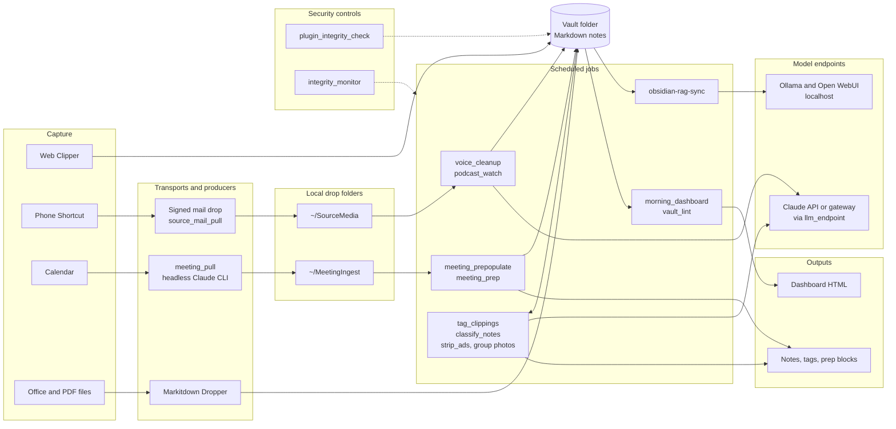

# Technical overview

This page is for an engineer, IT architect or technically minded adopter who
wants to know how the pieces fit together before installing or extending them.
For what the project does and who it is for, start with
[`Overview.md`](Overview.md). For the security model in depth, see
[`Security-Overview.md`](Security-Overview.md). Each feature has its own page;
this one links to them rather than repeating them.

## What it is

An Obsidian vault and a set of small Python jobs that run on top of it. The
vault holds plain Markdown notes in a fixed folder layout. The jobs, scheduled
by `launchd` on macOS and Task Scheduler on Windows, bring material in (web
clips, phone dictation, podcast transcripts, calendar data), tidy and tag it,
prepare meeting notes, build a morning dashboard, and watch the setup for
tampering. A model is used where judgement is needed (tagging, dictation
cleanup, classification proposals); everything else is deterministic code.

The design rules that shape it:

- **The repository is the vault.** You clone it to `~/Obsidian`
  (`%USERPROFILE%\Obsidian` on Windows), or link that path to the clone, and
  `.obsidian/` settings ship with it. Every content folder ships holding only
  a `.gitkeep` and is gitignored, because your real notes live in the same
  working tree as a public repository.
- **Local-first and plain files.** Notes are Markdown with YAML frontmatter.
  State, logs and baselines stay on the machine, outside the vault. Nothing
  requires a server of your own.
- **Shared Python, OS-specific glue.** The job logic is one set of
  cross-platform scripts in `Templates/Scripts/`. Only the schedulers,
  wrappers, notifications and installers are forked per platform.
- **Every job is idempotent and independently optional.** Each is installed
  by its own installer component, and re-running a job or a component is safe.
  Turning one off does not break the others.
- **Fail closed where security is at stake.** Signature checks, the export
  gate, plugin and dependency hashes, and the meeting producer's tool
  allowlist refuse rather than guess. Pure observability (logs, the network
  probe, the Windows run lock) fails open, so a broken helper cannot stop the
  work it reports on.

## Architecture at a glance



The vault folder is the only thing every layer shares. Producers never write
notes directly: they leave files in a drop folder outside the vault, and a
consumer job turns those into notes. The two security controls do not sit in
any data path; they watch the plugin folder, the scripts, the scheduled job
definitions and the rest of what the jobs run.

## The vault

**Folders.** `Clippings/` receives web clips, podcast transcripts and YouTube
summaries. `Creations/` holds your own writing plus cleaned dictation and
converted documents. `Meetings/`, `People/` and `Groups/` hold meeting notes,
contact records and rosters. `Knowledge/` is the curated home for graduated
notes, including the optional `Tag Taxonomy.md` allowlist the tagger
enforces. `Topics/` holds tag-driven pages, `Actions/` the to-do views, and
`Z_attachments/` images. `Z_dashboards/` is
written by the dashboard and gitignored. `Templates/` holds note templates,
`Bases/`, `QuickAdd/` scripts, and `Scripts/`, the automation.

**Templates and Bases.** Note creation goes through QuickAdd (the
`new_meeting.js` script picks Group, Individual or Ad-hoc and fills attendees
from a roster). The database views are Obsidian's core Bases, shipped as
`.base` files in `Templates/Bases/` and embedded with links such as
`![[Meetings.base#Person]]`. Dataview and Templater were retired in favour of
Bases and QuickAdd, because both could run code from note text.

**Plugins and pins.** The enabled community plugins are listed in
`.obsidian/community-plugins.json`. Their code is never committed. Each one
is pinned in `installers/plugin-pins.json` by repository, release tag, and
the download URL, size and SHA-256 of every file the installer fetches. The
installer refuses a file whose hash does not match. Pins move only when
someone runs `installers/lib/pin_plugins.py` and commits the result, and
`installers/lib/plugin_drift.py` checks an installed plugin against its pin.
QuickAdd's `main.js` is patched after install (component
`31-quickadd-patch`), so it is the one file expected to differ from its pin.
Only the settings files that drive ribbon icons, QuickAdd choices and the
like are tracked.

**Demo content.** `Templates/Scripts/seed_demo_content.py` writes an
obviously fictional dataset anchored to today's date, so the dashboard, Bases
and graph have something to show. Every file it writes carries
`demo_seed: generated` and `classification: public`, and `--remove` deletes
only files with that marker inside a known content folder. See
[`Demo-Content.md`](Demo-Content.md).

## The automation layer

### Jobs

Times are local. "Interval" jobs run on a fixed tick; "watch" jobs also fire
when a watched path changes (macOS `WatchPaths`). Optional jobs are installed
only when you accept their component.

| Job | Trigger, macOS / Windows | Reads | Writes | External calls |
|---|---|---|---|---|
| `tag_clippings.py` | every 30 min and at load / every 30 min | note bodies in `Clippings/`, `Creations/`, `Meetings/` | tags in frontmatter; unknown tags to a review file | model endpoint |
| `voice_cleanup.py` (optional) | always-on watcher polling every 10 s / every 5 min with `--once` | `~/SourceMedia/VoiceInput/` | cleaned note in `Creations/` | model endpoint |
| `source_mail_pull.py` (optional) | every 5 min / every 5 min, registered disabled | the intake mailbox | verified drops in `~/SourceMedia/` | IMAP |
| `podcast_watch.py` (optional) | every 15 min / every 15 min, one episode per run | `~/SourceMedia/PodcastInput/` | transcript in `Clippings/` | episode and feed hosts; pinned Whisper model download; transcription is local |
| `strip_ads.py` | watch on `Clippings/` / every 5 min | `Clippings/` | the same files, ad blocks removed | none |
| `meeting_prep.py` | every 5 min / every 5 min | today's individual meeting notes | a follow-up callout in each | none |
| `meeting_prepopulate.py` (opt-in on macOS) | watch on `~/MeetingIngest`, every 30 min, Sunday 21:00 / every 30 min | handoff files in `~/MeetingIngest` | meeting notes and People stubs | none |
| `meeting_pull.py` (opt-in) | weekdays 05:00, 06:30, 08:00 with `--skip-if-fresh` / weekdays 05:00, registered disabled | the calendar, through an MCP connector | handoff files in `~/MeetingIngest` | Claude CLI and calendar connector |
| `email_tasks.py` (opt-in) | weekdays 06:45 / weekdays 06:45, registered disabled | mail since the last run, through the MCP connector | `#task` lines in `Actions/Email Tasks.md` | Claude CLI and mail connector |
| `claude_auth_check.py` (opt-in, macOS, installed by hand) | 21:00 Sunday to Friday | none | a state marker | one Claude CLI request |
| group photos | daily 02:00 / daily 02:00 | `Groups/*.md`, `Z_attachments/` | photo embeds in rosters | none |
| `obsidian-rag-sync.py` (optional) | daily 03:15 / daily 03:00, enabled only where RAG is set up | the vault | Open WebUI Knowledge collection; a health report in `Creations/` | localhost |
| `classify_notes.py` (optional) | 05:00, 08:00, 12:30 / daily 05:00, registered disabled | changed note bodies | `classification_suggested`, or `restricted` from a detector | model endpoint (none with `--detectors-only`) |
| `plugin_integrity_check.py` | daily 06:30 and watch on the plugins folder / daily 06:30 | `.obsidian/plugins/` | alert log, notification | none |
| `integrity_monitor.py` | daily 06:35 and watch on scripts and LaunchAgents / daily 06:35 | scripts, job definitions, venv, config | alert log, notification | none |
| `morning_dashboard.py` | weekdays 07:00 / weekdays 07:00 | the vault, usage log, job status | `Z_dashboards/` HTML | none |
| `vault_lint.py` (optional) | Mondays 07:00, read-only / Mondays 07:00 | the vault and the repo clone | a report | none |

On demand, with no schedule: `youtube_summarize.py` (captions through
`yt-dlp`, summary through the model endpoint), `podcast_transcribe.py`,
`disclosure_check.py` (the export gate), `seed_demo_content.py`,
`tag_clippings_rag.py` (local Ollama embeddings to shortlist tags, then the
model endpoint), and the Markitdown Dropper app (on Windows, a Send To
shortcut to `markitdown_convert.py`). The dashboard's optional buttons start
some of these jobs through an `obsidian-dashboard://` URL handler; see
[`Dashboard-Actions.md`](Dashboard-Actions.md).

The macOS schedules live in the `Templates/Scripts/*.plist` templates, with
`YOUR_USERNAME` rendered at install. The Windows schedules live in one
manifest, `Templates/Scripts/windows/schedules.psd1`, which
`Register-Tasks.ps1` turns into tasks under `\Obsidian\`. A Windows job that
needs a per-user resource (a mailbox, a calendar connector) is registered
disabled; you prove it by hand and enable it.

### Two interpreters on macOS

Most dependencies install into one shared venv at `Templates/Scripts/.venv`,
which needs Python 3.10 or later and is built from Homebrew Python. It is
installed only from `requirements.lock`: every package at a locked release
with the SHA-256 of each file, installed with
`pip --require-hashes --no-deps --only-binary :all:`. The lock is generated
from `requirements.txt` by `installers/lib/lock_requirements.py`, never by
hand.

Many macOS jobs run on Apple's `/usr/bin/python3` instead, which is Python
3.9: both security controls, the dashboard, the meeting pull, email tasks, pre-population
and prep jobs, the auth check, vault lint, strip-ads and group photos. The
security controls and the dashboard do this on purpose, so they keep working
when the venv is broken, and an Apple-signed interpreter is not replaced by a
package upgrade. The rest are standard-library only and have no reason to
depend on the venv. The consequence is a rule for every script in
`Templates/Scripts/`: write 3.9-compatible code (no
`match`, no runtime `X | Y` unions, no nested same-quote f-strings).
`test_platform_hardening.py` parses that folder (and `Z_attachments/`, which now holds no code) with `/usr/bin/python3` to
enforce it.

On Windows every task runs the venv's interpreter, launched windowless.

### Logging, time limits and overlap

On macOS each plist sends output to `~/Library/Logs/<job>.log` (some jobs
also keep a separate `.err`). Task Scheduler has no equivalent, so every
Windows task runs its script through `run_logged.py`, which appends stdout
and stderr to `%LOCALAPPDATA%\obsidian-logs\<task>.log`, keeps one rotated
generation at 5 MB, and passes the job's exit code through unchanged.

`launchd` has no maximum run time, so on macOS hangs are bounded inside the
code. Every model call built by `llm_endpoint.client()` gets a 120 s timeout
and two retries (300 s for the dictation cleanup and the summarizer, whose
model thinks before answering). The meeting pull kills a CLI attempt after
600 s. Every Keychain call has a 15 s ceiling and is never retried. `launchd`
also never starts a second copy of a job that is still running.

On Windows each task has an execution time limit: the job's own
`TimeLimitMinutes` from the manifest, otherwise twice its interval (at least
15 minutes) or two hours for a daily or weekly job. `run_logged.py` enforces
its own limit two minutes earlier, because ending the wrapper alone would
orphan the job. When it fires it stops the job's whole process tree and exits
124. A minute before that, `job_boot.py` has `faulthandler` write every
thread's stack into the log, so a hang says where it was stuck.

Jobs that must not overlap take a single-instance lock through
`script_lock.py` (a `fcntl` or `msvcrt` lock on a file in
`Templates/Scripts/.locks/`). On Windows, `run_logged.py` also takes a
per-task lock, so a dashboard click and a scheduled run of the same job
cannot overlap.

External programs (ffmpeg, ffprobe, claude) are resolved through
`exe_lookup.find_executable`, which searches only absolute PATH entries
outside the working directory and the vault; Windows tasks start in
`%LOCALAPPDATA%\obsidian-logs`. Every LaunchAgent runs with umask 077 and
keeps Python bytecode out of the vault (`PYTHONDONTWRITEBYTECODE` and a
`PYTHONPYCACHEPREFIX` under `~/Library/Caches/obsidian-template`).

## Model access

**One endpoint module.** Every script that calls a hosted model builds its
client through `llm_endpoint.client()`. With nothing configured that is the
stock Anthropic API, using the secret named `ANTHROPIC_API_KEY`. Two entries
in the secrets `.env` move every caller to an institutional gateway with no
code change:

```
LLM_BASE_URL=https://api.ai.example.edu
LLM_API_KEY_NAME=EXAMPLE_AI_API_KEY
```

The config names the secret rather than carrying it, so the gateway key is
held in the platform keystore like any other. The gateway must speak the
Anthropic Messages API (`/v1/messages`, `x-api-key`), because the SDK's
`base_url` override changes nothing else; an OpenAI-shaped proxy needs a
translating layer in front of it.

Three behaviours matter on a gateway. Before each client is built, the
gateway hostname is resolved; if it does not resolve, the call fails with an
error that names the host and suggests the VPN, instead of the SDK's bare
`Connection error.` (`LLM_SKIP_PREFLIGHT=1`, or any proxy variable, turns
this off). Model names are translated: the first call lists the gateway's
served models (`GET /v1/models`) and sends each requested model under the
gateway's own spelling, ignoring date suffixes and dots versus dashes, so the
Anthropic model ids used as defaults work unchanged. And prompt caching is
left to each caller, since gateways differ on passing `cache_control`
through. `python3 llm_endpoint.py` prints which key and endpoint are in use
without making a call.

**Metering.** Each call appends one JSON line to a usage log outside the
vault (`usage_log.py`), recording the pipeline, model and token counts,
including cache reads and writes. The dashboard shows seven days of usage per
pipeline with a cost estimate at list prices. A gateway's contract price will
differ, but the relative cost per pipeline is what tells you where to
optimize.

**Headless Claude CLI sessions.** The meeting pull does not use
`llm_endpoint`. It drives the Claude Code CLI (`claude -p`), because the
calendar connector is reached through the CLI's own sign-in. Calendar invites
are text anyone can write, so the session is confined:

- `--restricted`, with an empty private temporary directory as the working
  directory, so there are no code-running tools and file tools reach nothing.
- `--permission-mode dontAsk`, so anything not pre-approved is refused.
- `--allowedTools` names exactly the connector's calendar search and event
  read tools, and `--disallowedTools` removes every other built-in tool and
  the rest of the connector (mail, chat, file search).
- `--json-schema` forces the reply into an `events` array, and
  `--output-format stream-json` exposes the session's tool list and calls.
- `--no-session-persistence`, so no transcript of meeting bodies is kept.

The optional email-tasks job (`email_tasks.py`) reuses this machinery with
the connector's mail search and item read as its two tools and a `requests`
schema; `email_task_transform.py` is its only writer. See
[`Email-Tasks.md`](Email-Tasks.md).

The script, not the session, writes the calendar JSON and runs the
deterministic transform. It refuses a session that lacked or never called the
calendar search, so a connector that failed to register reads as a failure
rather than an empty day. Authentication failures exit with their own code
and are not retried.

`claude_auth_check.py` sends one trivial request each evening, which both
refreshes a sliding session and reports an expired one while someone can
still sign in. The drift reviewer (below) uses the same CLI with
`--restricted`, `--strict-mcp-config`, `--tools Read,Grep,Glob` and
`dontAsk`, against a temporary copy of the repository.

## Data paths

What leaves the machine, and where it goes:

| Data | Path | Destination |
|---|---|---|
| Note bodies for tagging (capped at 4,000 characters), restricted notes withheld unless `LLM_ALLOW_RESTRICTED=1` on a gateway | `tag_clippings.py` | model endpoint |
| Note text a detector cannot decide, never a note already restricted | `classify_notes.py` | model endpoint |
| Dictation text, YouTube captions | `voice_cleanup.py`, `youtube_summarize.py` | model endpoint |
| Calendar events | connector, read inside a Claude Code session | Anthropic; the transform runs locally |
| Phone captures | signed, not encrypted, plain-text email | your mail provider, then IMAPS (certificate-verified TLS 1.2+) to the machine |
| Podcast audio | fetched from the episode's host | transcribed locally |
| Vault notes for chat | `obsidian-rag-sync.py` | Open WebUI and Ollama on localhost |
| The vault folder, if you use Obsidian Sync | Obsidian's own sync | Obsidian's servers, end-to-end encrypted |
| Repository diff and docs (maintainer only) | drift reviewer | Anthropic, through the CLI |
| Plugin files and Python packages | installer and updater | downloaded from GitHub releases and PyPI, hash-checked |
| The Open WebUI image and Ollama models (optional RAG stack) | RAG installers | downloaded from GitHub's container registry and Ollama's, pinned by digest (`installers/rag-pins.json`) |

Everything else stays local. The usage log, logs, job state and security
baselines sit outside the vault, so they never sync or appear in search.
Fetches of untrusted URLs go through `url_safety.py`, which refuses loopback,
link-local and private addresses and re-checks every redirect. Outside text
passes through `output_sanitizer` (remote images, HTML, non-web schemes,
Mermaid) where the writer can carry them, and `templater_guard.neutralize()`,
before it is written into a note, so it cannot load anything or trigger plugin
code when the note opens.

## Configuration, secrets and state

**Non-secret config** lives in `~/dev/secrets/.env`
(`%USERPROFILE%\dev\secrets\.env`): the gateway URL and key name, the Open
WebUI collection id, feature switches. Scheduled jobs do not inherit your
shell, so the installer writes what they need into this file. Per-job
settings that name people or tools (such as
`Templates/Scripts/.config/meeting_pull.json`) are gitignored.

**Secrets** go through `secret_store.get_secret(name)`, which checks the
environment first, then the platform keystore:

- macOS: a Keychain generic password read and written by shelling out to
  `/usr/bin/security`. Keychain access is granted per calling binary, and
  Homebrew Python changes identity on every upgrade; the Apple-signed
  `security` binary does not. Writes delete then add, never update in place,
  because an update can raise a consent dialog that an unattended job can
  never answer.
- Windows: a DPAPI-encrypted file under the security state directory, which
  only the logged-in user can decrypt.
- Elsewhere: a mode-0600 file, a plainly weaker fallback.

`python3 Templates/Scripts/secret_store.py set NAME` stores a value from a
hidden prompt or stdin, never from the command line.

**State** lives under `~/.local/share/` on macOS and `%LOCALAPPDATA%` on
Windows: `obsidian-security` (baselines, the signed plugin allowlist, the
alert log, Windows secrets), `obsidian-usage` (the usage log), `obsidian-logs`
(Windows job logs) and `obsidian-drift-review`. Regenerable scratch state
(`.locks/`, `.state/`, the tagger's tracking file) sits beside the scripts and
is gitignored.

## Install, update and uninstall

**Install.** `install.sh` runs numbered components from
`installers/components/` in order. Each detects what is already there and
installs or skips, so re-running is safe. They cover preflight checks
(Apple Silicon, macOS 14 or later), a classification audit of the tree,
Obsidian itself, the vault skeleton and venv, secrets, plugins from their
pins, one component per job, script permissions, an offer to record the
security baselines, and a final verification table. `--only`, `--skip`,
`--without-llm`, `--dry-run` and `--list` select what runs. The meeting
pre-population, meeting pull, email tasks and dashboard-button components ship off.

An **install profile** (`--profile`) pre-answers the prompts a stranger's
clone cannot: the gateway URL and key name, which opt-in components to turn
on, tenant domains, MCP tool names, time zone. Profiles name secrets and never
contain them. `install.sh` sources a profile as shell code, so read one before
running it; `install.ps1 -Profile` parses the same file as data. Real
profiles are gitignored. See
[`installers/profiles/README.md`](../installers/profiles/README.md).

On Windows, `install.ps1` does the same job, links `%USERPROFILE%\Obsidian`
to the clone with a directory junction when needed, and adds the local RAG
stack with `-WithRAG`. See [`Windows Setup.md`](Windows%20Setup.md).

**Update.** `update.sh` (and `update.ps1`) brings an existing install up to
date without re-asking every question:

1. Refuses to start while Obsidian is running (it would write its in-memory
   settings back over the pulled ones) or while a tracked file has local
   changes.
2. Pulls with `git pull --ff-only`, then re-runs itself from the pulled copy,
   so the remaining steps are the new code.
3. Reinstalls the requirements from the lock, hash-checked.
4. On macOS, re-renders each LaunchAgent this machine already has, and
   reloads only those whose git-tracked definition changed, with a diff and a
   backup; a changed agent with no installer component is named and left alone. A
   job you never installed is listed with the command that adds it, never
   added. On Windows, `Register-Tasks.ps1` re-registers every task and keeps
   any task you enabled by hand enabled.
5. Reinstalls plugins from their pins when the pins moved or an installed
   plugin no longer matches its pin, and re-applies the QuickAdd patch.
6. Removes retired jobs and retired plugins, from an explicit list (a plugin
   your notes still use is disabled but kept, with a warning).
7. Reports the security controls' status. It never adopts a new baseline;
   it says how to confirm that the reported drift is only the update.

**Uninstall.** `uninstall.sh` and `uninstall.ps1` remove the scheduled jobs,
wrapper apps, logs, venv and scratch state by default, and never your notes.
Secrets, the local LLM stack, plugins, demo content and (on Windows) apps and
models are separate flags. On Windows only the junction is removed, never the
clone behind it.

## Quality gates

**Tests.** `Templates/Scripts/tests/run_tests.sh` builds its own venv
(`.venv-test`) from `requirements-dev.lock`, so test tools never enter the
jobs' venv, and runs the suite with Keychain, network and state access
mocked. Some tests are structural: the uninstaller removes every shipped
LaunchAgent, every content folder has its gitignore lines, and every pip step
installs only from a lock.

**Security passes.** One entry point, `installers/lib/security-checks.sh`,
runs seven passes, each triggered by what a change touches:

- `sca`: `pip-audit` and lock verification, on dependency changes.
- `sast`: `semgrep` and `bandit`, on any Python change.
- `shell`: `shellcheck`, on any shell change.
- `secrets`: `gitleaks`, on any tracked file.
- `hooks`: the installed git hooks match the repository's copies.
- `content`: the classification audit and the identity gate over the public
  tree.
- `dast`: dynamic checks of network, path and transport behaviour.

The `pre-commit` hook runs `--fast` (secrets, shell, hooks) and `pre-push`
runs `--full` and refuses the push on any failure. Every run writes an
artifact outside the repository, a missing scanner is a named skip rather
than a pass, and accepted findings live in
`installers/lib/security-suppressions.txt` with a rationale and a re-check
date. See [`Security-Overview.md`](Security-Overview.md).

**Drift review.** After the push gates pass, `pre-push` can start
`installers/lib/drift_review.py` in the background: one confined Claude
session checks the documents against the pushed change, a second tries to
disprove each finding, and the survivors become `#task` lines in a vault
note. It is opt-in, configured outside the repository, and never blocks a
push. See [`Drift-Review.md`](Drift-Review.md).

## Extending it

**Adding a scheduled job.**

1. Write the script in `Templates/Scripts/`. If its plist will use
   `/usr/bin/python3`, keep it standard-library only and 3.9-compatible.
   Build model clients with `llm_endpoint.client()` and record usage with
   `usage_log.record()`. Fetch untrusted URLs through `url_safety.py`, pass
   outside text through `output_sanitizer.sanitize_report()` and then
   `templater_guard.neutralize()` before it reaches a note, and take a `script_lock` if runs can overlap.
2. Add `Templates/Scripts/com.<name>.plist` with `YOUR_USERNAME` paths and a
   log under `~/Library/Logs/`.
3. Add an entry to `windows/schedules.psd1`, with `TimeLimitMinutes` if it can
   run long and `Enabled=$false` if it needs a per-user resource.
4. Add an installer component that names the plist's template path:
   `update.sh` finds a job's component by that path. Teach `uninstall.sh` to
   remove the agent and its log.
5. Add tests, and document the job on its own page with a link from the
   README. A new script also changes what the integrity monitor sees, so
   expect to re-baseline after deploying it.

Retiring a job means adding it to `RETIRED_AGENTS` in
`installers/lib/update.sh` and `RetiredJobs` in `schedules.psd1`, so existing
installs remove it.

**Adding a producer.** The meeting consumer depends on a contract, not a
transport: a schema-v1 JSON payload with a SHA-256 sidecar, an optional
HMAC-SHA256 signature, and a `.ready` marker written last, read through the
`discover` / `load` / `ack` interface in `handoff_source.py`. Any producer
that writes that trio into `~/MeetingIngest` (or a folder set with
`MEETING_PREPOP_HANDOFF_DIR`) works with the consumer unchanged. Set
`HANDOFF_HMAC_KEY_FILE` and `HANDOFF_REQUIRE_SIGNATURE=1` to refuse unsigned
handoffs. A different calendar connector is a config change in
`meeting_pull.json`, not a fork. See
[`HANDOFF-ARCHITECTURE.md`](HANDOFF-ARCHITECTURE.md) and
[`Meeting-Handoff-MCP-Producer.md`](Meeting-Handoff-MCP-Producer.md).

**Using a different model endpoint.** Set `LLM_BASE_URL` and
`LLM_API_KEY_NAME` in the secrets `.env`, store the key with
`secret_store.py set`, and run `python3 Templates/Scripts/llm_endpoint.py` to
confirm. Per-pipeline model overrides exist where a job needs one (for
example `TAGGER_MODEL` and `YOUTUBE_MODEL`). A local model is reached through
the RAG stack instead; see
[`Local LLM with Obsidian Vault RAG.md`](Local%20LLM%20with%20Obsidian%20Vault%20RAG.md).

## Per-feature documentation

- [`Overview.md`](Overview.md) and [`Security-Overview.md`](Security-Overview.md)
- [`Windows Setup.md`](Windows%20Setup.md) and
  [`LaunchAgents — Setup & Migration.md`](LaunchAgents%20%E2%80%94%20Setup%20%26%20Migration.md)
- [`Obsidian Configuration Guide.md`](Obsidian%20Configuration%20Guide.md)
- [`Semantic Auto-Tagger Setup.md`](Semantic%20Auto-Tagger%20Setup.md)
- [`Source-Mail-Transport.md`](Source-Mail-Transport.md) and
  [`Source-Mail-Producer-Setup.md`](Source-Mail-Producer-Setup.md)
- [`Voice Notes (Optional).md`](Voice%20Notes%20%28Optional%29.md)
- [`YouTube Summarizer.md`](YouTube%20Summarizer.md)
- [`Markitdown Dropper.md`](Markitdown%20Dropper.md)
- [`Meeting-Pre-Population.md`](Meeting-Pre-Population.md),
  [`Meeting-Handoff-MCP-Producer.md`](Meeting-Handoff-MCP-Producer.md) and
  [`HANDOFF-ARCHITECTURE.md`](HANDOFF-ARCHITECTURE.md)
- [`Local LLM with Obsidian Vault RAG.md`](Local%20LLM%20with%20Obsidian%20Vault%20RAG.md)
- [`Dashboard-Actions.md`](Dashboard-Actions.md)
- [`Email-Tasks.md`](Email-Tasks.md)
- [`Data-Classification.md`](Data-Classification.md)
- [`Security-Harness.md`](Security-Harness.md)
- [`Vault-Lint.md`](Vault-Lint.md)
- [`Demo-Content.md`](Demo-Content.md)
- [`Drift-Review.md`](Drift-Review.md)
